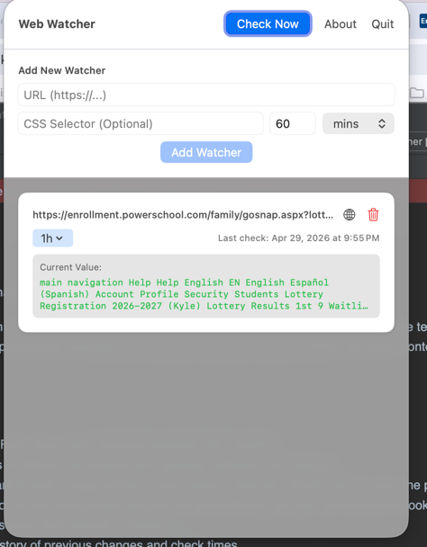

<p align="center">
  
</p>

# Web Watcher

Web Watcher is a native, highly efficient macOS Menu Bar application that tracks websites for changes. 

Instead of dealing with false positives from changing layout metadata, Web Watcher allows you to isolate exactly the text you care about using CSS selectors. It sits quietly in your Menu Bar, periodically checking your tracked URLs, and natively notifies you when content changes.

## Features
- **Native SwiftUI Menu Bar Interface:** Fast, clean, and integrates perfectly with macOS.
- **Smart Tracking:** Uses CSS selectors to extract only specific text, ignoring irrelevant site changes.
- **Unified Authentication Context:** Want to track a page behind a login screen? Click the "Globe" icon to open the page natively and log in. Web Watcher shares a WebKit process pool, so any background scrapes will automatically use your authenticated cookies.
- **Automated Scheduling:** Track pages every few minutes or hours.
- **History Logs:** Maintains a running history of previous changes and check times.



## System Design

The application is written 100% in Swift and utilizes the Swift Package Manager.

### Core Architecture
1. **AppKit + SwiftUI:** The app runs as an `NSApplicationDelegate` to hook into the `NSStatusItem` (Menu Bar) API. When the menu bar icon is clicked, it opens an `NSPopover` containing the SwiftUI `DashboardView`.
2. **SwiftSoup Parsing:** Uses the [SwiftSoup](https://github.com/scinfu/SwiftSoup) library (a Swift port of jsoup) to parse HTML and accurately query CSS selectors.
3. **Authentication via WebKit:** The application initializes a shared `WKProcessPool` and `WKWebsiteDataStore`. When background tasks run, they extract the active cookies from this data store and inject them into `URLSession` requests. This allows seamless tracking of authenticated content.
4. **Notifications:** Because the application is compiled as a raw executable (rather than an `.app` bundle with an `Info.plist`), it leverages macOS's native `osascript` to trigger AppleScript notifications, bypassing bundle identifier requirements for `UNUserNotificationCenter`.
5. **Persistence:** State is serialized using Swift `Codable` and saved natively to `~/Library/Application Support/WebWatcher/watcher_data.json`.
6. **Startup Integration:** The installed app (`~/Applications/WebWatcher.app`) registers itself once with `SMAppService.mainApp` to launch when you log in (macOS 13+). A bare build (`.build/debug`, Xcode's DerivedData) doesn't register, since each build path would become a login item of its own.
7. **One instance:** A second copy, of any build, sees the first one's lock (`~/Library/Application Support/WebWatcher/instance.lock`) and quits.

## How to Build

### Prerequisites
- A Mac running macOS 13 (Ventura) or newer.
- Xcode or the Swift Command Line Tools installed.

### Compilation
Navigate to the root directory of the project in your terminal and use the Swift Package Manager to fetch dependencies and compile the executable:

```bash
# Clone or navigate to the project directory
cd web_watcher

# Build the executable
swift build
```

## How to Install and Run

### Running Locally
To launch the app directly from the compiled binary:
```bash
.build/debug/WebWatcher
```
Once executed, the application will disappear from your Dock and appear as an "Eye" icon in your Menu Bar at the top right of your screen. 

### Installing
```bash
scripts/install.sh
```
This builds a release `WebWatcher.app` into `~/Applications`, signs it ad hoc and starts it. The app adds itself to Login Items (System Settings › General › Login Items) the first time it runs. Run the script again to update.

While developing, `.build/debug/WebWatcher` runs without touching Login Items. Quit the installed copy first, because only one Web Watcher runs at a time.
